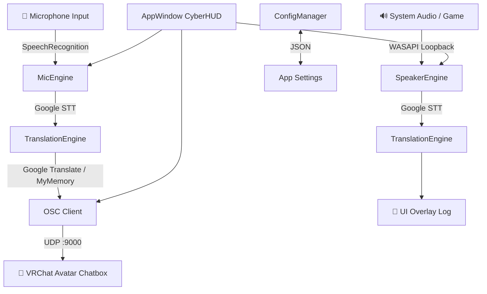

<div align="center">

# 🌐 EchoBridge
### Real-time AI Voice Translator for VRChat · v2.5

[](https://www.python.org/)
[](https://docs.vrchat.com/docs/osc-overview)
[](https://github.com/TomSchimansky/CustomTkinter)
[](LICENSE)
[](https://github.com/Zpati/VRChat-AI-Translator-Pro)
[](https://github.com/Zpati/VRChat-AI-Translator-Pro/releases)

<br/>

**Real-time AI-powered translator for VRChat** — Speak in your language, everyone understands.  
Dual-channel: **Mic → VRChat Chatbox** and **Game Audio → UI overlay**.

[🚀 Download EXE](#-quick-start) · [📖 English Setup Guide](SETUP_GUIDE_EN.md) · [📖 Türkçe Kurulum](SETUP_GUIDE_TR.md) · [⚠️ Known Limitations](TECHNICAL_LIMITATIONS.md) · [🐛 Report Bug](https://github.com/Zpati/VRChat-AI-Translator-Pro/issues)

</div>

---

## ✨ Key Features

| Feature | Description |
|---|---|
| 🎤 **Mic → VRChat** | Speak → AI detects language → Translates → Sends to VRChat Chatbox via OSC |
| 🎮 **Game Audio → UI** | Captures all system audio → Transcribes → Translates → Shows in overlay |
| 🌍 **50+ Languages** | Powered by Google Translate + MyMemory fallback |
| 🎨 **Cyberpunk HUD** | Dark neon UI, always-on-top overlay |
| 🌐 **EN / TR Interface** | Hot-swap UI language without restart |
| ⌨️ **Global Hotkeys** | F4 (Mic), F5 (Game Audio) — works while VRChat is focused |
| 📦 **Standalone EXE** | No Python install needed — just download and run |
| 🔇 **Noise Calibration** | Dynamic RMS threshold slider to filter background noise |
| 💬 **Typing Indicator** | VRChat `/chatbox/typing` simulation for natural feel |
| 📋 **Translation Cache** | 200-item LRU cache for instant repeat translations |

---

## 🏗️ Architecture



---

## 🚀 Quick Start

### Option A — Standalone EXE (Recommended, No Python Needed)

1. Download the latest release zip from [Releases](https://github.com/Zpati/VRChat-AI-Translator-Pro/releases)
2. Extract the zip
3. Open VRChat → **Settings → OSC → Enable OSC**
4. Run `dist/EchoBridge/EchoBridge.exe`
5. Select your mic language, target language, and hit **START**

### Option B — Run from Source (Python 3.10+)

```bash
git clone https://github.com/Zpati/VRChat-AI-Translator-Pro.git
cd VRChat-AI-Translator-Pro
pip install -r requirements.txt
python main.py
```

Or just double-click **`run.bat`**.

---

## ⚙️ VRChat OSC Setup

> [!IMPORTANT]
> OSC must be enabled in VRChat for translation to appear in your chatbox.

1. Launch VRChat
2. Open **Main Menu → Settings**
3. Scroll to **OSC** section
4. Toggle **Enable OSC** → **ON**
5. Confirm ports: **Input 9000**, Output 9001 (default)

See the full Turkish guide: [SETUP_GUIDE_TR.md](SETUP_GUIDE_TR.md)

---

## ⌨️ Hotkeys

| Key | Action |
|-----|--------|
| `F4` | Toggle Mic Translation (You → VRChat) |
| `F5` | Toggle Game Audio Capture (Game → UI) |

Hotkeys work globally — even when VRChat window is in focus.

---

## 📊 V1 vs V2.5 Comparison

| Feature | V1 (Original) | V2.5 Enterprise |
|---------|--------------|-----------------|
| UI | Basic tkinter | Cyberpunk CyberHUD (CustomTkinter) |
| Translation engine | Single API | Google Translate + MyMemory fallback |
| Game audio capture | ❌ | ✅ WASAPI Loopback |
| Hotkeys | ❌ | ✅ F4/F5 global |
| Language switcher | ❌ | ✅ EN/TR hot-swap |
| Standalone EXE | ❌ | ✅ PyInstaller |
| Translation cache | ❌ | ✅ 200-item LRU |
| Noise calibration | ❌ | ✅ Dynamic RMS slider |
| Config persistence | ❌ | ✅ JSON config |

---

## 🏗️ Build from Source (EXE)

```bash
pip install pyinstaller
build.bat
```

Output: `dist/EchoBridge/EchoBridge.exe`

> [!NOTE]
> Build excludes torch, tensorflow, scipy, matplotlib to keep EXE lightweight (~8MB core + dependencies).

---

## 📁 Project Structure

```
VRChat_Translator/
├── main.py                    # Entry point
├── run.bat                    # Quick launch script
├── build.bat                  # PyInstaller build script
├── requirements.txt
├── assets/
│   ├── icon.png               # 512x512 app icon
│   └── icon.ico               # Multi-resolution ICO (7 sizes)
├── src/
│   ├── main.py
│   ├── config.py              # ConfigManager (JSON settings)
│   └── ui/
│       ├── app_window.py      # Main CyberHUD window
│       ├── theme.py           # Cyberpunk color palette
│       └── locales.py         # EN/TR string tables
│   └── core/
│       ├── translator.py      # TranslationEngine + cache
│       ├── mic_engine.py      # Microphone STT + OSC bridge
│       ├── speaker_engine.py  # WASAPI Loopback capture
│       └── osc_client.py      # VRChat OSC UDP client
├── SETUP_GUIDE_TR.md          # Turkish OSC setup guide
├── TECHNICAL_LIMITATIONS.md  # Known issues & roadmap
└── LICENSE                    # MIT
```

---

## ⚠️ Known Limitations

| Issue | Status |
|-------|--------|
| Game audio captures ALL system sounds (not just VRChat) | By design — use RMS threshold slider |
| Google Translate rate-limit on heavy use | MyMemory fallback active |
| Game audio → translation lag ~2-4s | Inherent to STT pipeline |
| No speaker diarization (who said what) | Planned for v3.0 |
| Requires internet connection | Offline mode planned |

Full technical analysis: [TECHNICAL_LIMITATIONS.md](TECHNICAL_LIMITATIONS.md)

---

## 🛠️ Requirements

- Windows 10 / 11 (64-bit)
- Microphone (for Mic channel)
- Internet connection (for translation APIs)
- VRChat with OSC enabled

**Python dependencies** (for source run):
```
customtkinter>=5.2.0
speechrecognition>=3.10.0
pyaudio>=0.2.13
pyaudiowpatch>=0.2.12
deep-translator>=1.11.4
python-osc>=1.8.3
keyboard>=0.13.5
Pillow>=10.0.0
```

---

## 📄 License

MIT License — see [LICENSE](LICENSE)

---

<div align="center">

Made with ❤️ for the VRChat community  
**[Zpati](https://github.com/Zpati)** · **[ShinniUwU](https://github.com/ShinniUwU)** · EchoBridge v2.5

---

> 💡 *This project was our original idea. AI was used as a development assistant during the coding process.*

</div>

