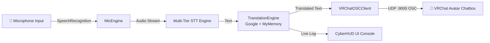

<div align="center">

# 🌐 EchoBridge
### Real-time AI Voice Translator for VRChat · v2.5

[](https://www.python.org/)
[](https://docs.vrchat.com/docs/osc-overview)
[](https://github.com/TomSchimansky/CustomTkinter)
[](LICENSE)
[](https://github.com/Zpati/EchoBridge)
[](https://github.com/Zpati/EchoBridge/releases)

<br/>

**Real-time AI-powered speech translator for VRChat** — Speak in your native language, and let your avatar communicate with the world.  
Seamless pipeline: **Microphone Input → Multi-Engine AI Translation → VRChat Avatar Chatbox via OSC**.

[🚀 Download EXE](#-quick-start) · [📖 English Setup Guide](SETUP_GUIDE_EN.md) · [📖 Türkçe Kurulum](SETUP_GUIDE_TR.md) · [🐛 Report Bug](https://github.com/Zpati/EchoBridge/issues)

</div>

---

## ✨ Key Features

| Feature | Description |
|---|---|
| 🎤 **Mic → VRChat** | Speak into your mic → Speech recognized → Instantly translated → Sent to your VRChat avatar's chatbox via OSC |
| 🎛️ **Audio Device Selector** | Choose any connected microphone directly from the UI dropdown |
| 🛡️ **Resilient Fallbacks** | Multi-tier translation pipeline (Google Translator + direct MyMemory REST API fallback) |
| 🌍 **Multi-Language Support** | Türkçe, English, Japanese, Korean, German, French, Spanish, Russian, Chinese, Italian, Arabic |
| 🎨 **Cyberpunk HUD** | Clean dark neon UI with Always-on-Top overlay support |
| 🌐 **EN / TR Interface** | Hot-swap UI language instantly without restarting the app |
| ⌨️ **Global Hotkey** | Press **F4** anywhere to toggle listening on/off (works while VRChat has focus) |
| 📦 **Standalone EXE** | Download and run — no Python installation needed |
| 💬 **Typing Indicator** | Simulates native VRChat `/chatbox/typing` for realistic conversations |
| 📋 **Translation Cache** | In-memory LRU cache prevents duplicate translations and lag |

---

## 🏗️ Architecture



---

## 🚀 Quick Start

### Option A — Standalone EXE (Recommended, No Python Needed)

1. Download the latest release package from [Releases](https://github.com/Zpati/EchoBridge/releases)
2. Extract the downloaded zip file
3. Launch VRChat → **Action Menu (R) → Options → OSC → Enabled (ON)**
4. Run **`EchoBridge.exe`**
5. Select your microphone, choose your languages, and press **START** (or hit **F4**)

### Option B — Run from Source (Python 3.10+)

```bash
git clone https://github.com/Zpati/EchoBridge.git
cd EchoBridge
pip install -r requirements.txt
python main.py
```

Or simply double-click **`run.bat`**.

---

## ⚙️ VRChat OSC Setup

> [!IMPORTANT]
> OSC must be turned ON in VRChat for translated messages to appear in your avatar's chatbox.

1. Launch VRChat
2. Press **R** (desktop) or open your radial action menu in VR
3. Select **Options** → **OSC**
4. Toggle **Enabled** to **ON**
5. EchoBridge connects automatically to standard OSC port (`127.0.0.1:9000`).

---

## ⌨️ Hotkeys

| Key | Action |
|-----|--------|
| `F4` | Toggle Microphone Translation ON/OFF |

---

## 📁 Project Structure

```
EchoBridge/
├── main.py                    # Application Entry Point
├── run.bat                    # Quick launch script
├── build.bat                  # PyInstaller build script
├── requirements.txt           # Python dependencies
├── assets/
│   ├── icon.png               # High-res app icon
│   └── icon.ico               # Multi-resolution Windows ICO (7 frames)
├── src/
│   ├── config.py              # Persistent settings manager (config.json)
│   ├── ui/
│   │   ├── app_window.py      # Streamlined single-channel CyberHUD window
│   │   ├── theme.py           # Cyberpunk neon color palette
│   │   └── locales.py         # EN / TR string tables
│   └── core/
│       ├── translator.py      # Multi-engine translation with MyMemory fallback
│       ├── mic_engine.py      # Microphone capture & device selection
│       └── osc_client.py      # VRChat OSC UDP bridge
├── SETUP_GUIDE_EN.md          # English setup guide
├── SETUP_GUIDE_TR.md          # Türkçe kurulum rehberi
└── LICENSE                    # MIT License
```

---

## 📄 License

MIT License — see [LICENSE](LICENSE)

---

<div align="center">

Made with ❤️ for the VRChat community  
**[Zpati](https://github.com/Zpati)** · **[ShinniUwU](https://github.com/ShinniUwU)** · EchoBridge v2.5

---

> 💡 *This project was our original idea. AI was used as a development assistant during the coding process.*

</div>
